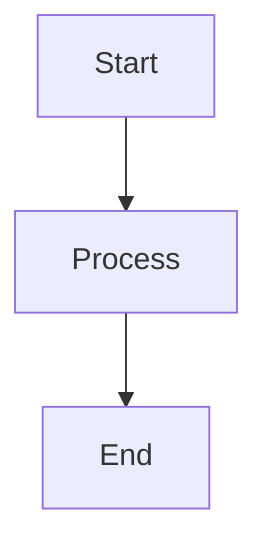
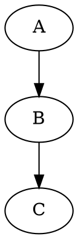

# Build a Production-Grade Markdown Viewer Chrome Extension

## Objective

Build a complete, production-ready Google Chrome Extension that provides a powerful Markdown reading, rendering, navigation, presentation, annotation, diagram, math, and export experience.

The product should provide functionality comparable to modern Markdown viewer extensions such as MarkView, but it must be an **independent implementation**.

Do NOT copy proprietary source code, branding, logo, screenshots, exact visual assets, or implementation details from any existing extension.

You may use the publicly observable feature set as product requirements and use reputable open-source libraries under their respective licenses.

The extension must feel polished, fast, modern, reliable, and suitable for production use.

---

# 1. Product Name

Use a temporary working name:

**MarkdownView Pro**

Keep the architecture flexible so the product name, logo, colors, and branding can easily be changed later.

---

# 2. Core Goal

When a user opens:

* `.md`
* `.markdown`
* `.mdown`
* `.mkd`
* `.mdx`
* `.txt`
* raw Markdown URLs

the Chrome extension should detect the content and provide a beautiful rendered Markdown experience.

It should support:

* local files
* raw GitHub files
* raw GitLab files
* Bitbucket raw files
* Gitea raw files
* Markdown hosted on arbitrary websites
* `.txt` files containing Markdown
* drag-and-drop Markdown files
* manually opening a Markdown file

The extension should not interfere with websites that already provide their own Markdown rendering unless the user explicitly enables such behavior.

---

# 3. Technology Requirements

Use:

* Chrome Extension Manifest V3
* TypeScript
* modern HTML/CSS
* modular architecture
* Vite or another reliable modern bundler
* Chrome Extension APIs
* local-only processing by default

Recommended libraries:

* markdown-it or equivalent Markdown parser
* highlight.js or equivalent syntax highlighter
* KaTeX for mathematical expressions
* Mermaid for diagrams
* DOMPurify for sanitization
* a suitable DOCX generation library
* suitable libraries for HTML/PDF export where necessary

Use open-source dependencies with compatible licenses.

Do not unnecessarily introduce React, Next.js, backend servers, databases, or cloud infrastructure.

Prefer a lightweight browser-native architecture.

---

# 4. Privacy Requirement

The application must be privacy-first.

By default:

* Markdown content must remain inside the browser.
* Do not upload Markdown files to a backend.
* Do not create analytics.
* Do not add telemetry.
* Do not track users.
* Do not collect personal information.
* Do not send document contents to third-party AI services.
* Settings should use chrome.storage.local.
* Recent documents should be stored locally.
* Annotations should be stored locally.

Any optional feature that requires network access must clearly disclose it and require explicit user consent.

---

# 5. Markdown Rendering

Implement high-quality Markdown rendering.

Support:

* headings
* paragraphs
* bold
* italic
* strikethrough
* inline code
* fenced code blocks
* ordered lists
* unordered lists
* nested lists
* task lists
* blockquotes
* tables
* links
* images
* horizontal rules
* HTML where safely supported
* footnotes
* anchors
* definition-style content where supported
* automatic heading IDs
* escaping/sanitization
* GitHub-style Markdown
* common GitHub extensions

Support Markdown extensions where practical.

Ensure malformed Markdown does not crash the viewer.

---

# 6. MDX / Extended Markdown

Provide reasonable handling of `.mdx`.

The viewer must never execute arbitrary JavaScript contained inside a document.

Unsafe executable JSX/components should be treated safely.

The priority is:

1. safe rendering
2. useful Markdown output
3. graceful fallback for unsupported MDX syntax

Never execute untrusted document code.

---

# 7. Syntax Highlighting

Implement syntax highlighting for a large number of programming languages.

At minimum support:

* JavaScript
* TypeScript
* Python
* Java
* C
* C++
* C#
* PHP
* Go
* Rust
* Ruby
* Kotlin
* Swift
* SQL
* Bash
* PowerShell
* JSON
* YAML
* XML
* HTML
* CSS
* SCSS
* Markdown
* Dockerfile
* GraphQL
* Terraform
* Java
* Scala
* Dart

Support many additional languages through the selected syntax-highlighting library.

Features:

* language detection
* language label
* copy button
* line wrapping option
* readable code typography
* dark/light syntax themes
* optional line numbers

---

# 8. Mermaid Diagrams

Implement Mermaid support.

Recognize fenced blocks such as:



Support common Mermaid diagrams:

* flowcharts
* sequence diagrams
* class diagrams
* state diagrams
* entity relationship diagrams
* Gantt charts
* pie charts
* journey diagrams
* mindmaps where supported

Requirements:

* render diagrams inline
* show useful error messages when Mermaid syntax is invalid
* fullscreen diagram mode
* zoom
* pan
* reset zoom
* download diagram
* avoid breaking the document when a diagram fails

Never execute arbitrary JavaScript from Markdown.

---

# 9. PlantUML

Support PlantUML blocks.

Provide a configurable PlantUML rendering mechanism.

Important:

* PlantUML network rendering must be OFF by default if it requires an external server.
* Clearly explain that external rendering may send diagram content to that server.
* Give the user an explicit opt-in setting.
* If possible, support local/client-side rendering.

The application must continue functioning normally if PlantUML rendering is unavailable.

---

# 10. Graphviz

Support Graphviz/DOT diagrams.

Example:



Render diagrams safely.

Provide:

* inline rendering
* fullscreen
* zoom
* pan
* export/download where technically possible

---

# 11. Math / KaTeX

Implement KaTeX support.

Support:

Inline:

```text
$E = mc^2$
```

Display:

```text
$$
E = mc^2
$$
```

Support complex LaTeX notation where KaTeX supports it.

Requirements:

* inline equations
* block equations
* readable mathematical typography
* error handling
* dark/light theme compatibility
* print/export compatibility

---

# 12. Table of Contents

Automatically generate a TOC from:

* H1
* H2
* H3
* H4
* H5
* H6

TOC features:

* collapsible sidebar
* active-section highlighting
* scroll spy
* smooth scrolling
* nested heading hierarchy
* clickable headings
* mobile-friendly behavior
* toggle shortcut

The TOC must remain synchronized with the document while scrolling.

---

# 13. Reading Progress

Add a reading progress indicator.

It should show:

* current reading position
* percentage completed

It should update smoothly while scrolling.

Allow the user to enable/disable it.

---

# 14. Word Count and Reading Time

Display document statistics:

* word count
* character count
* estimated reading time

Calculate these locally.

Allow statistics to appear in a document information panel.

---

# 15. Raw / Rendered View

Provide a toggle between:

**Rendered View**

and

**Raw Markdown View**

The user should be able to switch instantly.

Keyboard shortcut should be configurable.

---

# 16. File Browser

Implement a local Markdown folder browser.

Users should be able to:

* select a folder
* browse directories
* see Markdown files
* open files
* search files
* filter files
* sort files
* navigate between directories

Support common project structures such as:

```text
project/
├── README.md
├── CHANGELOG.md
├── docs/
│   ├── architecture.md
│   ├── api.md
│   └── setup.md
└── guides/
    └── deployment.md
```

Do not upload the folder anywhere.

---

# 17. Folder Search

When a folder is opened, provide full-text search across Markdown files.

Search should support:

* filename search
* content search
* case-insensitive search
* result highlighting
* file path display
* quick open

Do not scan files unnecessarily.

Use efficient asynchronous processing.

---

# 18. Folder Bookmarks

Allow users to bookmark frequently used directories.

Features:

* add folder bookmark
* remove bookmark
* rename bookmark
* open bookmarked folder
* store bookmarks locally

---

# 19. Recent Documents

Maintain a local list of recently opened documents.

Show:

* filename
* path/source
* last opened time

Allow:

* reopen
* remove individual item
* clear history

Do not transmit recent-document information anywhere.

---

# 20. Auto Refresh

Implement automatic refresh for local Markdown files.

When an external editor modifies a Markdown file:

1. detect the change where browser APIs allow it
2. reload the document
3. preserve the user's scroll position where possible
4. preserve theme/settings
5. update the rendered content

Make auto-refresh configurable.

---

# 21. Image Viewer

Images inside Markdown should support a professional lightbox.

Features:

* click image to enlarge
* fullscreen
* zoom
* pan
* next/previous image
* gallery navigation
* image counter
* close button
* keyboard navigation
* lazy loading

Support relative image paths where browser permissions allow them.

Handle broken images gracefully.

---

# 22. External Links

Improve external Markdown links.

Features:

* external-link indicator
* safe target behavior
* optional confirmation for suspicious URLs
* preserve normal browser navigation

Do not break normal Markdown linking.

---

# 23. Sticky Table Headers

For large tables:

* keep header row visible while scrolling
* preserve readable borders
* support horizontal scrolling
* support responsive behavior

Do not distort tables.

---

# 24. Annotations

Implement document annotations.

Users should be able to:

* highlight text
* underline text
* add comments/notes
* view existing annotations
* edit annotations
* delete annotations

Annotations should persist locally.

Associate annotations with:

* document identity
* selected text
* approximate location
* annotation type
* timestamp

Handle document modifications gracefully.

Annotations should never modify the original Markdown file unless explicitly requested.

---

# 25. Presentation Mode

Implement a presentation mode that converts Markdown headings/sections into slides.

Example:

```markdown
# Introduction

Content

---

# Architecture

Content

---

# Conclusion

Content
```

Presentation features:

* slide navigation
* next/previous
* keyboard controls
* fullscreen
* progress indicator
* slide counter
* touch navigation
* optional auto-play
* presentation themes
* speaker notes where practical

Support:

* arrow keys
* PageUp/PageDown
* Space
* Escape

Allow returning to normal document view.

---

# 26. Mind Map Mode

Create a mind-map representation of the document structure.

Use headings to generate the hierarchy.

Example:

```text
Project
├── Architecture
│   ├── Frontend
│   └── Backend
├── Database
└── Deployment
```

Mind-map features:

* interactive navigation
* zoom
* pan
* collapse/expand
* fullscreen
* SVG export
* PNG export
* JPEG export where practical

The mind map must be generated entirely from document structure.

---

# 27. Export

Implement export capabilities.

Required:

### HTML

Export rendered Markdown to a standalone HTML document.

The exported file should preserve:

* typography
* headings
* tables
* code blocks
* syntax highlighting
* images where possible
* Mermaid diagrams
* KaTeX equations
* basic styling

### DOCX

Provide DOCX export.

Preserve:

* headings
* paragraphs
* lists
* tables
* code blocks
* images
* basic formatting
* math/diagram representations where technically possible

### PDF

Provide clean PDF printing.

Use browser print/PDF functionality where appropriate.

The print output must:

* hide application controls
* use print-specific CSS
* preserve page breaks
* avoid cutting tables incorrectly
* preserve code blocks
* preserve diagrams
* preserve mathematical formulas
* include useful document margins

### Image Export

Where appropriate, support exporting diagrams/mind maps as:

* SVG
* PNG
* JPEG

---

# 28. Dark and Light Themes

Provide:

* Light
* Dark
* System

Theme changes should apply consistently to:

* Markdown
* code
* Mermaid
* KaTeX
* TOC
* browser UI
* presentation mode
* mind map

Persist the setting locally.

---

# 29. Typography

Provide configurable typography.

Settings should include:

* font family
* font size
* line height
* content width
* code font
* heading scale

Provide several high-quality font choices.

Ensure accessibility and readability.

---

# 30. Layout Settings

Allow users to customize:

* document width
* sidebar width
* TOC visibility
* folder browser visibility
* progress bar
* statistics
* raw/rendered mode
* code line wrapping
* sticky tables

Persist all settings.

---

# 31. RTL Support

Support right-to-left documents.

Languages/scripts may include:

* Arabic
* Hebrew
* Persian
* Urdu

Requirements:

* automatic direction detection where practical
* manual direction setting
* correct text alignment
* correct lists
* correct tables
* correct code blocks
* correct TOC
* correct presentation mode
* correct print/export
* correct mind-map layout where practical

Do not globally force RTL when only a paragraph requires it.

---

# 32. Internationalization

Design the UI using i18n from the beginning.

Do NOT hardcode user-facing strings.

Create a translation architecture supporting languages such as:

* English
* Spanish
* French
* German
* Italian
* Portuguese
* Dutch
* Polish
* Russian
* Chinese Simplified
* Chinese Traditional
* Japanese
* Korean
* Vietnamese
* Indonesian
* Arabic
* Persian
* Urdu
* Hebrew

The architecture should make adding another language easy.

---

# 33. Accessibility

Follow accessibility best practices.

Support:

* keyboard navigation
* visible focus states
* ARIA labels
* semantic HTML
* screen readers
* sufficient contrast
* reduced-motion preference
* scalable typography
* accessible dialogs
* accessible menus

Do not make critical functionality mouse-only.

---

# 34. Keyboard Shortcuts

Implement useful shortcuts.

Examples:

```text
Ctrl/Cmd + Shift + D
    Toggle theme

Ctrl/Cmd + Shift + L
    Toggle TOC

Ctrl/Cmd + Shift + B
    Toggle file browser

Ctrl/Cmd + F
    Search document

Esc
    Close fullscreen/dialog

Arrow Left
    Previous slide/image

Arrow Right
    Next slide/image
```

Make shortcut handling configurable where Chrome permissions/API allow it.

Avoid conflicts with important browser shortcuts.

---

# 35. Chrome Extension Architecture

Use Manifest V3.

Create a clean architecture such as:

```text
src/
├── background/
│   └── service-worker.ts
│
├── content/
│   ├── content.ts
│   └── content.css
│
├── viewer/
│   ├── renderer/
│   ├── markdown/
│   ├── mermaid/
│   ├── math/
│   ├── diagrams/
│   ├── syntax/
│   └── sanitization/
│
├── components/
│   ├── toc/
│   ├── toolbar/
│   ├── sidebar/
│   ├── browser/
│   ├── lightbox/
│   ├── annotations/
│   ├── presentation/
│   └── mindmap/
│
├── export/
│   ├── html/
│   ├── docx/
│   └── print/
│
├── settings/
├── i18n/
├── storage/
├── utils/
└── styles/
```

You may improve this structure if there is a better architectural approach.

Keep modules loosely coupled.

---

# 36. Security

Security is extremely important because the extension processes arbitrary Markdown from the internet and local files.

Implement:

* DOM sanitization
* safe URL handling
* protection against XSS
* safe HTML rendering
* no arbitrary script execution
* safe Mermaid handling
* safe SVG handling
* CSP
* secure iframe strategy where necessary
* safe external-resource handling

Do not trust Markdown content.

Do not execute JavaScript embedded in Markdown.

Do not allow Markdown to escape the extension security boundary.

---

# 37. Performance

The extension should remain fast for normal technical documentation.

Optimize for:

* large README files
* long documentation pages
* hundreds of headings
* many code blocks
* many images
* multiple diagrams
* large tables

Use:

* lazy image loading
* incremental rendering where appropriate
* debounced search
* asynchronous file scanning
* efficient DOM updates
* cached parsed content where appropriate

Avoid unnecessary re-rendering.

---

# 38. Error Handling

Never show a blank screen when rendering fails.

Create useful error states for:

* invalid Markdown
* invalid Mermaid
* invalid PlantUML
* invalid Graphviz
* invalid LaTeX
* unsupported MDX
* inaccessible local file
* unavailable image
* unsupported export
* permission errors

Display human-readable messages.

Provide recovery actions where possible.

---

# 39. Extension Popup

Create a clean popup containing:

* Open Markdown file
* Open folder
* Recent documents
* Bookmarked folders
* Theme
* Settings
* Help/About

Keep the popup lightweight.

Do not put the complete application inside the popup.

---

# 40. Settings Page

Create a proper extension settings page.

Sections:

### Appearance

* theme
* font
* font size
* line height
* content width

### Markdown

* GitHub-style rendering
* HTML rendering
* raw mode
* code line numbers

### Navigation

* TOC
* progress bar
* sticky headers

### Diagrams

* Mermaid
* PlantUML
* Graphviz

### Files

* auto-refresh
* recent documents
* folder behavior

### Export

* HTML
* DOCX
* print/PDF

### Language

* interface language
* text direction

### Privacy

* explain local-only processing
* optional external PlantUML server setting

All settings must persist using Chrome local storage.

---

# 41. Supported URL Detection

Detect raw Markdown sources.

Examples:

```text
file:///C:/project/README.md

https://raw.githubusercontent.com/user/repo/main/README.md

https://gitlab.com/user/project/-/raw/main/README.md

https://example.com/docs/readme.md

https://example.com/file.markdown

https://example.com/file.mdx

https://example.com/llms.txt
```

Do not automatically replace normal rendered pages such as:

* GitHub repository pages
* GitHub blob pages
* GitBook
* ReadTheDocs

unless the user explicitly enables that behavior.

---

# 42. File Access

Support local files using the appropriate Chrome permissions and APIs.

The user should be able to enable:

**Allow access to file URLs**

Provide clear instructions when permission is missing.

Never request unnecessary permissions.

Follow Chrome Web Store permission-minimization requirements.

---

# 43. Drag and Drop

Allow users to drag a Markdown file into the viewer.

Support:

* `.md`
* `.markdown`
* `.mdown`
* `.mkd`
* `.mdx`
* `.txt`

Show a clear drop zone.

---

# 44. Toolbar

Create a polished document toolbar containing useful actions such as:

* back
* forward
* TOC
* file browser
* search
* raw/rendered toggle
* theme
* presentation
* mind map
* annotations
* export
* settings

Toolbar should become compact/sticky while scrolling.

Avoid visual clutter.

---

# 45. Search Inside Document

Implement document search.

Features:

* search text
* match count
* next match
* previous match
* highlight matches
* keyboard navigation
* case sensitivity option where useful

Search must work on rendered document content.

---

# 46. Responsive Design

The viewer must work on:

* desktop
* laptop
* smaller browser windows
* tablet-sized layouts

On small screens:

* collapse sidebars
* convert TOC to drawer
* simplify toolbar
* maintain readable typography
* preserve diagrams and tables through horizontal scrolling

---

# 47. Visual Design

Create an original premium developer-focused design.

Design characteristics:

* clean
* minimal
* modern
* professional
* excellent typography
* subtle borders
* restrained shadows
* strong spacing system
* excellent dark mode
* excellent light mode

Do NOT clone another extension's exact UI.

The application should feel like a high-quality developer tool.

---

# 48. First-Run Experience

When the extension is installed for the first time:

show a simple onboarding screen:

1. Welcome
2. Explain local/private processing
3. Explain local file permission
4. Open sample Markdown
5. Show Mermaid example
6. Show math example
7. Show keyboard shortcuts
8. Finish

Do not require account creation.

---

# 49. Demo Document

Create a bundled sample Markdown document demonstrating:

* headings
* TOC
* table
* code
* Mermaid
* Graphviz
* PlantUML
* KaTeX
* images
* links
* task lists
* blockquotes
* annotations
* presentation sections

This should make testing the extension easy.

---

# 50. Testing Requirements

Create comprehensive tests.

Test:

### Markdown

* headings
* lists
* tables
* code
* links
* images
* HTML
* malformed Markdown

### Security

* XSS attempts
* malicious HTML
* malicious SVG
* JavaScript URLs
* embedded scripts
* unsafe Mermaid content

### Diagrams

* valid Mermaid
* invalid Mermaid
* Graphviz
* PlantUML
* large diagrams

### Math

* inline
* display
* complex formulas
* invalid formulas

### Files

* local Markdown
* remote Markdown
* inaccessible files
* large files
* UTF-8
* Unicode
* RTL

### UI

* dark mode
* light mode
* responsive layout
* keyboard navigation

### Export

* HTML
* DOCX
* print/PDF
* diagram images
* mind maps

### Performance

Test with:

* 1 MB Markdown
* 5 MB Markdown
* thousands of lines
* hundreds of headings
* many images
* many code blocks

---

# 51. Browser Compatibility

Primary:

* Google Chrome

Architecture should also remain compatible with Chromium browsers such as:

* Microsoft Edge
* Brave
* Opera
* Vivaldi

Do not introduce Chrome-only functionality unless necessary.

---

# 52. Manifest Permissions

Use the minimum required permissions.

Before adding any permission, determine:

1. why it is needed
2. whether it can be avoided
3. whether a narrower permission can be used
4. whether Chrome Web Store review could reject it

Document every permission in the project.

---

# 53. Documentation

Create:

```text
README.md
ARCHITECTURE.md
SECURITY.md
PRIVACY.md
DEVELOPMENT.md
TESTING.md
RELEASE.md
CHANGELOG.md
```

README must explain:

* installation
* development
* build
* loading unpacked extension
* local file access
* supported Markdown
* diagrams
* math
* export
* settings
* troubleshooting

---

# 54. Build Requirements

The project must support:

```bash
npm install
npm run dev
npm run build
npm run test
npm run lint
```

The final production build should generate a clean extension package.

No backend should be required to run the extension.

---

# 55. Chrome Installation Testing

After implementation:

1. Build the extension.
2. Open `chrome://extensions`.
3. Enable Developer Mode.
4. Load the unpacked `dist` directory.
5. Test the extension on local `.md` files.
6. Test raw GitHub Markdown.
7. Test remote Markdown.
8. Test diagrams.
9. Test math.
10. Test exports.
11. Test folder browsing.
12. Test presentation mode.
13. Test mind-map mode.
14. Test annotations.
15. Test dark/light mode.
16. Test RTL.
17. Test keyboard shortcuts.
18. Test security.
19. Test large documents.
20. Fix all discovered problems.

---

# 56. Quality Gate

Do NOT consider the project complete merely because the extension builds.

The following must all be true:

* no TypeScript errors
* no build errors
* no console errors during normal usage
* no broken UI states
* no obvious security vulnerabilities
* no unnecessary permissions
* Markdown rendering works
* Mermaid works
* KaTeX works
* Graphviz works
* PlantUML works or has graceful fallback
* syntax highlighting works
* TOC works
* search works
* folder browser works
* auto-refresh works
* annotations work
* presentation mode works
* mind map works
* HTML export works
* DOCX export works
* print/PDF works
* image viewer works
* RTL works
* i18n architecture works
* dark/light themes work
* accessibility works
* large documents remain usable

---

# 57. Development Process

Follow this implementation sequence:

## Phase 1 — Foundation

Build:

* Manifest V3
* TypeScript
* Vite
* project structure
* storage
* basic viewer
* Markdown parser
* sanitization
* local file support

Then test.

## Phase 2 — Rendering

Implement:

* syntax highlighting
* tables
* images
* TOC
* search
* themes
* responsive layout

Then test.

## Phase 3 — Diagrams and Math

Implement:

* Mermaid
* KaTeX
* Graphviz
* PlantUML

Then test security and failure scenarios.

## Phase 4 — File Management

Implement:

* folder browser
* folder search
* bookmarks
* recent files
* auto-refresh

Then test large projects.

## Phase 5 — Productivity

Implement:

* annotations
* reading progress
* word count
* reading time
* raw mode
* image lightbox

## Phase 6 — Advanced Modes

Implement:

* presentation mode
* mind map

## Phase 7 — Export

Implement:

* HTML
* DOCX
* print/PDF
* diagram export
* mind-map export

## Phase 8 — Internationalization

Implement:

* i18n
* RTL
* language detection
* manual direction

## Phase 9 — QA

Perform complete functional, security, performance, accessibility, and compatibility testing.

## Phase 10 — Production Polish

Fix:

* UI inconsistencies
* spacing
* typography
* animations
* keyboard issues
* error states
* loading states
* permissions
* Web Store compliance issues

---

# 58. Important Claude Code Instructions

You are acting as a senior Chrome Extension engineer, frontend architect, security engineer, and QA engineer.

Do NOT rush directly into implementation.

First:

1. inspect the repository
2. determine whether an existing project exists
3. inspect package.json
4. inspect current architecture
5. identify reusable code
6. create an implementation plan
7. identify technical risks
8. identify Chrome Manifest V3 constraints
9. identify required permissions
10. then implement

If the repository is empty, initialize the project.

Do not ask unnecessary questions.

Make reasonable engineering decisions yourself.

When a requirement has multiple implementation approaches, choose the safest and most maintainable approach.

---

# 59. Important Independence Requirement

The final application must be an independently developed product.

Do not:

* copy MarkView source code
* copy proprietary code
* copy exact branding
* copy logos
* copy proprietary assets
* copy website content
* copy screenshots
* impersonate the existing product

The goal is:

**"Build a Markdown viewer with comparable capabilities and quality, not a source-code clone."**

Use original implementation and original UI design.

---

# 60. Final Deliverables

At the end provide:

1. complete source code
2. production build
3. Chrome extension `dist` folder
4. README
5. architecture documentation
6. security documentation
7. privacy documentation
8. test suite
9. test report
10. supported-feature matrix
11. known limitations
12. installation instructions
13. Chrome Web Store preparation checklist

Also provide a final report containing:

```text
IMPLEMENTED
- feature
- feature
- feature

TESTED
- feature
- feature

KNOWN LIMITATIONS
- limitation
- limitation

PERMISSIONS
- permission + reason

SECURITY
- implemented protections

PERFORMANCE
- test results

BUILD
- build command
- output directory

NEXT RECOMMENDATIONS
- optional improvements
```

Do not claim a feature is complete unless it has actually been implemented and tested.

If something cannot be implemented exactly because of Chrome API limitations, explain the limitation and implement the closest robust alternative.
