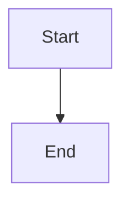
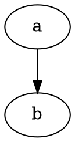

# Markora Demo Document

This document exercises every construct Markora's rendering pipeline
supports: headings and a table of contents, tables, code blocks, Mermaid
and Graphviz diagrams, an opt-in PlantUML diagram, KaTeX math, images,
links, task lists, blockquotes, GitHub-style alerts, custom containers,
annotation-friendly prose, and a presentation-mode-ready slide break. It's
also the guided tour opened from the first-run onboarding flow's "Open
sample document" step.

## Headings and text

# H1 heading

## H2 heading

### H3 heading

#### H4 heading

##### H5 heading

###### H6 heading

Regular paragraph text with **bold**, _italic_, ~~strikethrough~~, and
`inline code`. A [text link](https://example.com) shows an external-link
indicator; an [](https://example.com)
does not.

A non-English heading, to exercise Unicode-safe anchors:

## 日本語の見出し

## Lists

- Unordered item one
- Unordered item two
  - Nested item

1. Ordered item one
2. Ordered item two

- [ ] An unchecked task
- [x] A checked task

## Definition list

Markora
: A privacy-first Markdown viewer.

Extension
: Runs entirely client-side.

## Blockquote

> A plain blockquote, rendered normally.

## GitHub-style alerts

> [!NOTE]
> This is a note.

> [!TIP]
> This is a tip.

> [!IMPORTANT]
> This is important.

> [!WARNING]
> This is a warning.

> [!CAUTION]
> This is a caution.

## Custom containers

:::info
An info container.
:::

:::warning
A warning container.
:::

:::danger
A danger container.
:::

:::details Click to expand
Collapsible details content.
:::

:::spoiler
A hidden spoiler.
:::

## Table

| Feature    | Status | Notes         |
| ---------- | ------ | ------------- |
| Tables     | ✓      | Sticky header |
| Footnotes  | ✓      | See below[^1] |
| Task lists | ✓      | Above         |

## Code

```javascript
function greet(name) {
  return `Hello, ${name}!`;
}
```

```python
def greet(name):
    return f"Hello, {name}!"
```

## Diagrams

Mermaid and Graphviz diagrams render fully offline — no network request is
ever made for either of them.





PlantUML diagrams are the one exception in Markora: rendering them requires
sending the diagram _source_ (never the rest of the document) to a
configurable server, so the feature is off by default. Enable it in
Settings → Privacy — the disclosure there names the exact server URL before
you turn it on. With it off, the block below shows a clear inline notice
instead of silently doing nothing.

```plantuml
Alice -> Bob: Hello
```

## Math

Inline math: $E = mc^2$

Display math:

$$
\int_0^1 x^2\,dx = \frac{1}{3}
$$

## Footnotes

[^1]: A footnote definition.

## Try annotating this

Select any sentence in this section and use the toolbar's Annotations
button to highlight, underline, or comment on it — annotations are stored
locally per document and survive reloads.

## Horizontal rule

---

## Images


## Presentation mode

The `---` line above also doubles as this document's presentation-mode
slide separator — open the toolbar's Presentation button to step through
it as slides, complete with the speaker notes you're reading right now if
you add an HTML comment under any heading.
